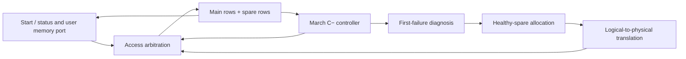

# Memory BIST and Repair — RTL Simulation Project

A parameterized, synthesizable memory built-in self-test and repair subsystem with March C− testing, fault diagnosis, spare-row allocation, and post-repair verification. This project is completed as a **simulation-based engineering demonstrator**; FPGA/ASIC implementation and timing closure are outside its validated scope.

## Architecture



The controller tests spares, diagnoses raw main memory, then verifies the remapped memory. Normal accesses are enabled only after verification succeeds. Each word is treated as a repairable row.

| Module | Purpose |
|---|---|
| `mbist_bisr` | March sequencing, diagnosis, spare screening/allocation, translation |
| `mbist_subsystem` | External-memory interface, user arbitration and response signaling |
| `mbist_ram` | Portable inferred physical RAM |
| `mbist_memory` | Self-contained subsystem and RAM |

Defaults are 16 main words × 8 bits and two spare words. `READ_LATENCY` supports combinational reads (0) or one-cycle registered reads (1). The controller/subsystem default to 0; reference RAM/self-contained top default to 1. Set matching parameters explicitly when wiring separate modules.

## Run in WSL/Linux

Required: Python 3, Make, Icarus Verilog, Yosys. Cocotb 2.x enables Python-driven tests. Verilator plus g++ enable strict lint and second-simulator tests; GTKWave is optional.

```bash
python3 -m venv .venv
source .venv/bin/activate
python -m pip install -r requirements.txt
make verify
make demo
```

`make verify` reports unavailable optional tools as explicit skips. A passing run with skips is not equivalent to executing every suite. The final project run includes Cocotb; see the recorded results below.

```bash
make test        # Icarus directed tests and parameter matrix
make cocotb      # integrated Python tests at both latencies
make formal     # bounded controller proofs
make formal-port # bounded repaired user-port proofs
make synth      # generic synthesis/checks
make lint       # strict Verilator lint
make verilator  # second-simulator integration tests
make package    # verify, archive, and test fresh extraction
```

The diagnosis demo runs healthy memory, successful repair, rejected-spare repair, and spare-exhaustion scenarios. It saves JSON reports and VCD waveforms:

```bash
python3 examples/run_demo.py --scenario bad_spare --latency 1 --waves
gtkwave build/demo/latency_1/bad_spare/wave.vcd
```

## Interface contract

Reset is synchronous and active low; the subsystem gates external memory enables immediately while reset is asserted. Pulse `start` for one cycle while idle. Starts during busy are ignored; holding start high retriggers after completion. Testing destroys contents and clears previous repair mappings. Completion/diagnostic outputs remain latched until reset or another start.

Wait for `done` and `repair_pass`. `fault_found` may remain high after successful repair. `unrepairable` means capacity exhaustion or a failed verification pass. `spare_bad` identifies rejected spares. `first_fail_addr` is a physical address, `first_fail_mask` is the observed/expected XOR, and `fail_count` counts failing reads with saturation—not unique faulty rows.

`user_ready` indicates availability. Requests while low are not queued. Accepted writes occur on rising edges. Combinational reads assert `user_rvalid` with the request; registered reads return data after the accepting edge with valid until the next edge. There is no response backpressure. Reset/start cancels a response. Data is zero when valid is low.

## Verification and results

- Fourteen Icarus geometry/latency configurations, plus dedicated controller, RAM, fixture and self-contained-top tests.
- Two hundred reproducible mixed stuck-bit fault simulations checked against an independent transaction/diagnosis/mapping oracle.
- Eight bounded proofs for controller behavior and repaired user accesses.
- Four mutation tests that must reject intentionally broken RTL.
- Forty-two strict lint configurations and four Verilator simulation configurations.
- Cocotb integration tests at both read latencies, including fault campaigns and reset/restart.

Read the [final technical report](docs/FINAL_REPORT.md), [machine-readable result summary](docs/results.json), and [verification method](docs/VERIFICATION.md). Full regenerable logs live under `build/`; they are excluded from Git. Source archives include selected evidence and a per-file manifest.

## Limits

No hardware board, SRAM macro, technology-specific timing, power or area signoff is claimed. Generic synthesis does not establish block-RAM inference. Formal proofs use a small bounded instance; selected transition, decoder and coupling models are directed examples, not exhaustive defect coverage. Repair is volatile, word-granular, and fixed during verification. Defect type cannot be uniquely inferred from the first mismatch. There is no fuse programming, ECC, multiport arbitration or production fault-coverage guarantee.
